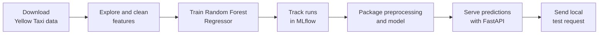

# NYC Taxi Trip Duration Model


This project predicts the duration of NYC Yellow Taxi trips in minutes using January 2025 TLC trip data. It combines:

- data exploration and feature engineering in a Jupyter notebook,
- a baseline `RandomForestRegressor`,
- hyperparameter tuning with `RandomizedSearchCV`,
- local experiment tracking and model registration with MLflow,
- reusable Python modules for configuration, data preparation, training, and model registry access,
- and a FastAPI API for serving predictions from the registered model.

The data target is `trip_duration_minutes`, calculated from the pickup and dropoff timestamps. The reusable feature set is `trip_distance` and `total_amount`.

## What This Project Demonstrates

- An end-to-end regression workflow for real-world NYC taxi trip data.
- Separation of exploration, data preparation, training, and serving concerns.
- Local experiment tracking and model comparison with MLflow.
- Promotion of the best-performing model to a registered production alias.
- Deployment of predictions through a FastAPI endpoint.

## Project Workflow



| File / Folder | Description |
|---|---|
| [**Exploration Notebook**](notebooks/data_exploration_and_experimentation.ipynb) | EDA, cleaning decisions, baseline modelling, tuning, and MLflow experiments. |
| [**Training Script**](src/training/train.py) | Reproducible baseline training entry point with MLflow logging and registry promotion. |
| [**Reusable Source Modules**](src/) | Shared settings, feature preparation, and model registry helpers. |
| [**FastAPI App**](serve/api.py) | Loads the configured MLflow model and serves trip-duration predictions. |

### Additional Folders and Files

| File / Folder | Description |
|---|---|
| [**pyproject.toml**](pyproject.toml) | Project configuration and dependencies. |
| [**uv.lock**](uv.lock) | Dependency lock file. |

## Setup

Use [uv](https://docs.astral.sh/uv/getting-started/installation/) 0.13.5 or newer
and Python 3.13.17 or a newer 3.13 patch release, as defined in
[`.python-version`](.python-version).

### 1. Install Dependencies

This installs all dependencies and creates a virtual environment in `.venv/`.

```bash
uv sync
```

---

### 2. Open the Repository in VS Code

> [!NOTE]
> Make sure you open VS Code from the project root so it automatically detects the environment created by `uv sync`.

Launch VS Code in the project root folder:

```bash
code .
```

If you create a notebook to explore the data, select the Python environment created by `uv sync` as the kernel.

---

### 3. Configure the Local Environment

Copy the committed environment template before running the notebook or training script:

```bash
cp .env.example .env
```

The `.env` file contains local configuration and must **not** be committed to Git. It is intentionally excluded by `.gitignore`; only `.env.example` is versioned.

The default template configures:

| Variable | Purpose | Default |
|---|---|---|
| `MLFLOW_TRACKING_URI` | MLflow tracking server address | `http://127.0.0.1:5000` |
| `MLFLOW_EXPERIMENT_NAME` | Experiment used for training runs | `yellow-taxi-duration` |
| `MLFLOW_MODEL_NAME` | Registered model name | `rfr-ride-duration` |
| `MODEL_ALIAS` | Alias that identifies the promoted model | `production` |
| `TRAIN_DATA_URI` | Local or remote Parquet training source | January 2025 TLC URL |

## Development Overview

### Data Exploration and Cleaning

The [exploration notebook](notebooks/data_exploration_and_experimentation.ipynb) downloads the January 2025 Yellow Taxi Parquet file if it is not already present, inspects 3.47 million source rows and their data types, and evaluates candidate features.

The raw dataset contains 3,475,226 trips and 20 columns. This is one example record; the target `trip_duration_minutes` is calculated from the pickup and dropoff timestamps and is not a source column. IDs and flags are coded categories, not measurements.

| Column | Example value | What it represents |
|---|---:|---|
| `VendorID` | `1` | Code for the data provider. |
| `tpep_pickup_datetime` | `2025-01-01 00:18:38` | Local time when the trip began. |
| `tpep_dropoff_datetime` | `2025-01-01 00:26:59` | Local time when the trip ended. |
| `passenger_count` | `1` | Recorded number of passengers. |
| `trip_distance` | `1.60` | Recorded trip distance in miles. |
| `RatecodeID` | `1` | Code for the fare rate applied to the trip. |
| `store_and_fwd_flag` | `N` | Whether the trip record was stored in the vehicle before being sent. |
| `PULocationID` | `229` | Taxi Zone code where the trip began. |
| `DOLocationID` | `237` | Taxi Zone code where the trip ended. |
| `payment_type` | `1` | Code for the payment method. |
| `fare_amount` | `$10.00` | Metered fare for the trip. |
| `extra` | `$3.50` | Additional fare charges. |
| `mta_tax` | `$0.50` | MTA tax recorded for the trip. |
| `tip_amount` | `$3.00` | Recorded tip amount. |
| `tolls_amount` | `$0.00` | Recorded toll charges. |
| `improvement_surcharge` | `$1.00` | Improvement surcharge. |
| `total_amount` | `$18.00` | Total charge recorded for the trip. |
| `congestion_surcharge` | `$2.50` | Congestion surcharge. |
| `Airport_fee` | `$0.00` | Airport-related fee, if applicable. |
| `cbd_congestion_fee` | `$0.00` | Central Business District congestion fee, if applicable. |
| `trip_duration_minutes` | `8.35` | Derived target: elapsed time between pickup and dropoff, in minutes. |

The exploratory cleaning decisions include:

- deriving trip duration from pickup and dropoff timestamps,
- retaining trips lasting between 1 minute and 6 hours,
- retaining positive, plausible trip distances up to a 60 mph, 6-hour upper bound,
- investigating and filtering implausible fare amounts,
- examining location routes and fare/distance relationships,
- and selecting `trip_distance` and `total_amount` as the initial feature set.

Visual and summary analyses compare trip duration against trip distance and total fare. Route information was explored but not included in the baseline feature set.

> [!IMPORTANT]
> **Lesson learned:** The initial analysis showed little or no correlation between ride distance and trip duration, which was unexpected for a trip-duration model. This was caused by extreme and implausible outliers in the raw data. After deriving the target and filtering invalid durations, distances, and fares, the relationship became usable for modelling. A surprising lack of correlation can be a data-quality signal rather than evidence that a feature is weak.

### Baseline Modelling

The baseline model is a `RandomForestRegressor` with 100 trees, a maximum depth of 15, at least 2 observations per leaf, and `random_state=42`. The notebook used a 30% test split and reported:

- MAE: 3 minutes
- MSE: 27
- RMSE: 5 minutes
- R²: 0.796

RMSE is the main comparison metric and is logged as `rmse_minutes`.

### Hyperparameter Tuning

The notebook also uses `RandomizedSearchCV` to tune the Random Forest on a smaller 20,000-row subsample for practical runtime. A 3-fold cross-validation search samples forest depth, features, leaf/split sizes, bootstrap sample size, and tree count.

The tuned run reported:

- best cross-validation RMSE: 6.157 minutes,
- test RMSE: 5.606 minutes,
- selected parameters: 207 estimators, maximum depth 40, 50% of features, 60.82% max samples, minimum leaf size 2, and minimum split size 13.

Tuning must be compared with the same held-out data and measurement setup before promotion. The MLflow registry promotion logic only assigns or replaces the `production` alias when the candidate has a strictly lower `rmse_minutes`.

### MLflow Experiment Tracking

MLflow is the local source of truth for experiment runs, parameters, metrics, serialized models, and registered model versions.

Start the MLflow server from the repository root **before** running the notebook or training script:

```bash
uv run mlflow server \
  --host 127.0.0.1 \
  --port 5000 \
  --backend-store-uri sqlite:///mlflow.db \
  --default-artifact-root ./mlartifacts \
  --allowed-hosts "localhost:5000,127.0.0.1:5000"
```

Keep the server running in a separate terminal. Open the UI at <http://127.0.0.1:5000>.

This setup stores tracking metadata in `mlflow.db` and model artifacts in `mlartifacts/`. Both are local generated files and should not be committed.

### Python Refactoring

Repeated modelling and registry logic has been moved out of the notebook into reusable modules:

- `src/common/config.py` loads `.env` values and centralized project settings.
- `src/common/features.py` owns feature names, target creation, cleaning, ride IDs, and prediction-frame construction.
- `src/common/model_registry.py` configures tracking, creates experiments, registers model aliases, compares RMSE, and resolves models.
- `src/training/train.py` provides a configurable baseline training command.

The training script downloads or reads the configured data source, applies the shared cleaning rules, creates a 70/30 train/test split, trains the baseline model, logs parameters and RMSE to MLflow, registers the model, and promotes it to the configured alias only if it improves on the current production score.

## Run the Training Script

Start the MLflow server first, ensure `.env` exists, and run:

```bash
uv run python -m src.training.train
```

Useful overrides are available on the command line:

```bash
uv run python -m src.training.train \
  --experiment-name yellow-taxi-duration \
  --registered-model-name rfr-ride-duration \
  --model-alias production \
  --test-size 0.3 \
  --random-state 42
```

The script prints the MLflow run ID, test RMSE, and whether the new registered model version was promoted.

## Repository Layout

```text
data/                                  downloaded local dataset
notebooks/                             data exploration and experiments
src/common/                            shared settings, features, registry helpers
src/training/train.py                  baseline training entry point
serve/api.py                           FastAPI prediction endpoint
tests/test_api.py                      API request and validation tests
mlflow.db                              local MLflow metadata (generated)
mlartifacts/                           local MLflow model artifacts (generated)
.env.example                           versioned configuration template
.env                                   local secrets/configuration (not versioned)
```

## Working with the Results

1. Run the MLflow server.
2. Open <http://127.0.0.1:5000> and compare runs.
3. Run the training script to create a new baseline run and registered model version.
4. Inspect the `production` alias to identify the currently selected model.
5. Use the registered model URI `models:/rfr-ride-duration@production` or the resolved alias through `src/common/model_registry.py` for downstream inference.

## Serve Predictions

Start the MLflow server and make sure the configured registered model alias exists. Then launch the API from the repository root:

```bash
uv run uvicorn serve.api:app --host 127.0.0.1 --port 8000
```

Open <http://127.0.0.1:8000/docs> for the interactive API documentation. The `POST /predict` endpoint accepts the same two features used for training:

```json
{
  "trip_distance": 2.4,
  "total_amount": 18.5
}
```

The API accepts trip distances from 0.1 to 360 miles and total amounts from $0 to $1,000, matching the ranges retained during training. Out-of-range inputs receive a `422` response. Valid requests return the predicted duration in minutes and the resolved MLflow model URI. The API reads `MLFLOW_TRACKING_URI`, `MLFLOW_MODEL_NAME`, and `MODEL_ALIAS` from the project environment configuration.
